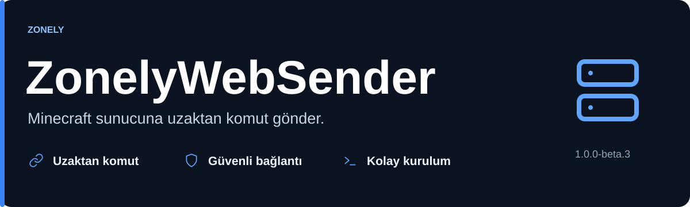
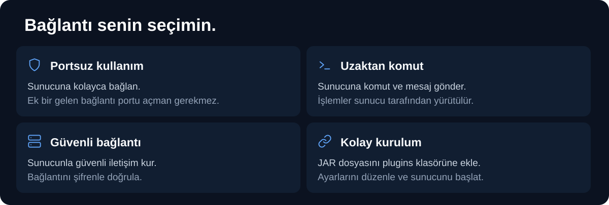

ZonelyWebSender, Minecraft sunucuna uzaktan konsol komutu ve sohbet mesajı göndermeni sağlayan bir eklentidir. Mağaza teslimatlarını, oyuncu ödüllerini ve yönetim komutlarını sunucuna ulaştırmak için kullanabilirsin.

[JAR indir](https://github.com/zonely-gen-tr/ZonelyWebSender/releases/tag/v1.0.0-beta.3) · [Kurulum](docs/AYARLAR.md)

**Sürüm hedefi:** Minecraft 1.8.8 ve üzeri Spigot/Paper; güncel 26.3 serisi dahil. Geniş sürüm desteği için Bukkit altyapısını kullanır.

- **Portsuz kullanım:** Sunucu bağlantıyı HTTPS üzerinden başlatır; oyun sunucusunda ek bir gelen bağlantı portu açman gerekmez.
- **Portlu kullanım:** Klasik WebSender bağlantısını kullanmaya devam edebilirsin.
- **Komut ve mesaj:** Konsol komutlarını çalıştırabilir, oyunculara mesaj gönderebilirsin.
- **Şifreyle bağlantı:** Panelde ve eklentide aynı bağlantı şifresini kullanırsın.

1. [Yayınlar sayfasından](https://github.com/zonely-gen-tr/ZonelyWebSender/releases) JAR dosyasını indir.
2. Dosyayı Minecraft sunucunun `plugins` klasörüne koy ve sunucuyu bir kez başlat.
3. `plugins/ZonelyWebSender/config.yml` dosyasını aç.
4. Kullanacağın bağlantı türünü seç; [ayarlar rehberindeki](docs/AYARLAR.md) örneğe göre bağlantı bilgilerini yaz.
5. Sunucuyu yeniden başlat ve panelden bir deneme komutu gönder.

Portsuz bağlantıda panelinin ZonelyWebSender bağlantısını desteklemesi ve sana bir HTTPS bağlantı adresi sağlaması gerekir. Portlu bağlantıda kullandığın portun erişilebilir olması gerekir.
