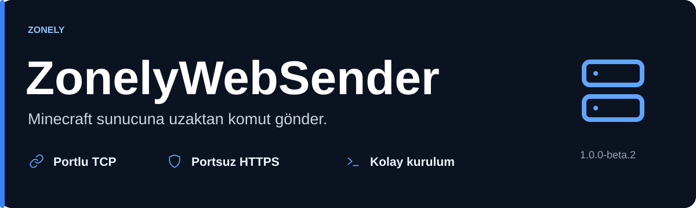
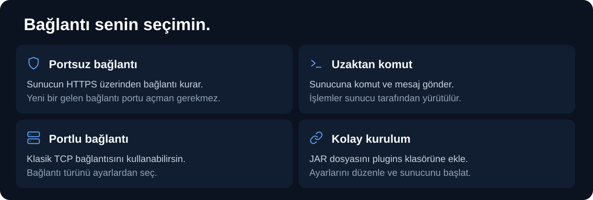
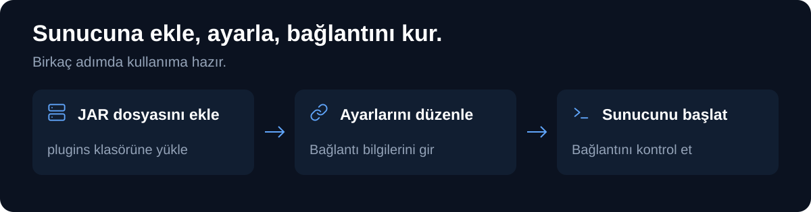

Minecraft sunucuna uzaktan komut ve mesaj gönder. Portlu TCP veya portsuz HTTPS bağlantısını seç.

[JAR indir](https://github.com/zonely-gen-tr/ZonelyWebSender/releases/tag/v1.0.0-beta.2) · [Ayarlar](docs/AYARLAR.md)

## Kurulum

1. JAR dosyasını `plugins/` klasörüne ekle.
2. Sunucuyu başlat; oluşan `plugins/ZonelyWebSender/config.yml` dosyasını düzenle.
3. Bağlantı bilgilerini girip sunucuyu yeniden başlat.

## Sürüm desteği

Spigot/Bukkit tabanlı sunucular için geliştirilmiştir. Java 8 bytecode ile derlenir. Minecraft 1.8.8 ve güncel sürümler hedeflenir; 26.3 üzerinde gerçek çalışma doğrulaması henüz beklenmektedir. Paper 26.3 sunucusunu Java 25 ile çalıştırmalısın.

Sürüm: **1.0.0-beta.2**.
