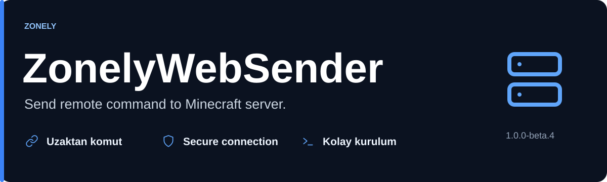
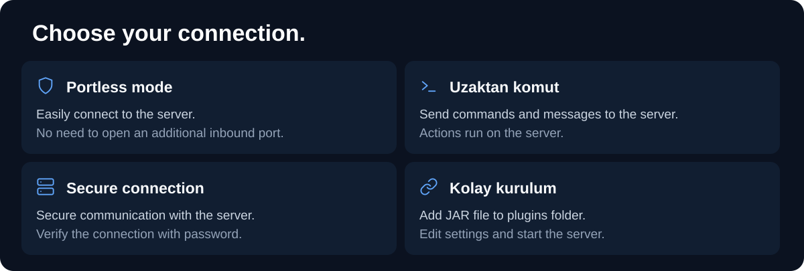
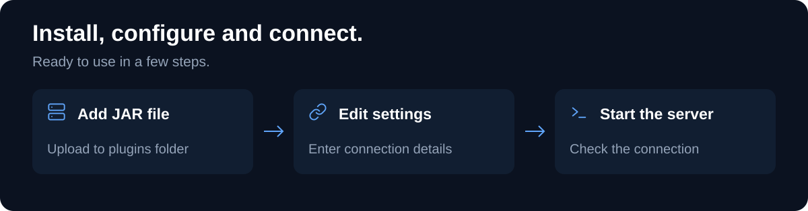

Send remote console commands and chat messages to your Minecraft server. Use ZonelyWebSender for store deliveries, player rewards and server administration.

[Download JAR](https://github.com/zonely-gen-tr/ZonelyWebSender/releases/tag/v1.0.0-beta.7) · [Configuration](docs/AYARLAR.md)

Forum resources: [Title](docs/TANITIM-BASLIK.txt) · [BBCode](docs/SPIGOTMC-BBCODE.txt)

**Compatibility target:** Minecraft 1.8.8 and later on Spigot/Paper, including the 26.3 series. The plugin uses Bukkit APIs for broad version support.

- **Portless mode:** The server initiates an outbound HTTPS connection. No additional inbound port is required on the game server.
- **Port-based mode:** Continue using a classic WebSender connection.
- **Commands and messages:** Run console commands and send messages to players.
- **Shared password:** Configure the same connection password in the panel and plugin.

1. Download the JAR from [Releases](https://github.com/zonely-gen-tr/ZonelyWebSender/releases).
2. Place it in your Minecraft server's `plugins` folder and start the server once.
3. Open `plugins/ZonelyWebSender/config.yml`.
4. Choose a connection mode and enter the settings shown in the [configuration guide](docs/AYARLAR.md).
5. Restart the server and send a test command from the panel.

For portless mode, set `relay-url` to your Zonely website address, such as `https://siteadresin.com`. A trailing slash is optional and the connection path is completed automatically. Your panel must support the ZonelyWebSender integration. For port-based mode, the configured port must be reachable.
